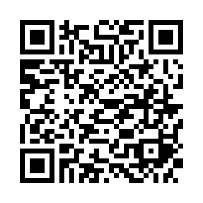

# Orbe — carteira automática no Expo Go

Publicação23/10/2026, remota, iOS/SDK57. Não depende do PC/rede local.

Link direto: exp://u.expo.dev/update/01a169c1-09cf-7835-9041-7aaa0218c70b

Update01a169c1-09cf-7835-9041-7aaa0218c70b · grupoa8d7b0de-0ec5-4d27-98bf-787fee242284 · commitf2eceac7383896a3192c40490b299e9e235243b5 · EAS69843dfe-ab1b-469e-bb78-c7948bbf1d9b · preview · runtimeexposdk:57.0.0. Manifesto/scheme/hashHBC/QRoficial conferidos.

## Abrir

Use sua conta existente. Mercado Pago e Bradesco estão ativos. Nubank já foi validado pela origemOpenFinance612 e cadastrado: ao abrir a nova versão, a sessão do titular prepara e ativa automaticamente o vínculo pendente, depois lê os produtos disponíveis. Não precisa copiar o Item ID novamente ou importar extrato.

O app mantém cache financeiro criptografado neste iPhone ao fechar e o restaura depois de validar acesso e conexões. As atualizações acontecem discretamente no app aberto; cache recente evita leituras duplicadas. Valores começam ocultos: toque Mostrar valores e descrições. Sair da conta ou Apagar cache deste iPhone e bloquear remove chave e arquivos.

Para futuros bancos suportados, use **Adicionar banco** e selecione a conexão na carteira Meu Pluggy aberta pelo app. O identificador chega automaticamente pelo callback e é revalidado pelo servidor. A API pessoal não lista itens externos: bancos criados fora do Orbe precisam ser selecionados nesse fluxo, sem mandar IDs ao chat. [Guia da automação/cache](AUTOMATIC-WALLET.md).

## Validação e limites

1270checks(1122Node+148Python), tiposcliente/backend, exportiOS/Hermes, audit1250fontes/58instâncias/advisoryrootsausentesJS, scansprivados eallowlist47. CI39992630145success. Migration20 e fixtureSQL/RLS instaladas/hashverificadas, rollback/zeroresíduos/ownerpreservado. Backendbridge24/metadata17/8flagsfontesdigestsidentidades verificados;11rotasanônimos401/no-store. Nenhuma finança real consultada por ferramentas.

Primeira leituraNubank e cache/Connect nativos ainda precisam de confirmação no aparelho. Não afirmar que o cadastro técnico já é uma leitura financeira. InvestimentosMP/Bradesco terminaram sem posições recebidas; isso não prova patrimôniozero. Cofrinhos dependem da fonte; desconhecidos não são inventados nem duplicados no saldo. Cartões/faturas continuam no planejamentoT80. FaceID/cadastro público/recuperação desligados; nenhum serviço pago contratado.
