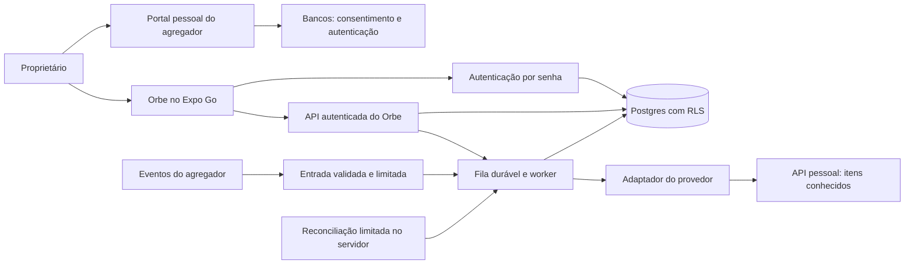

# Plano de implementação — após as specs

**Revisão vigente 0.4:** [SPEC-009](../specs/009-meu-pluggy/spec.md) seleciona Meu Pluggy para integração automática Bradesco/Mercado Pago PF. [Plano vigente](../plan/MEU-PLUGGY.md). Esta revisão prevalece sobre escolhas conflitantes abaixo; importação/local sem agregador é contingência, não caminho principal. Pesquisa pública permite seguir no planejamento, sem aprovação de dados reais.

> Revisão vigente 0.3: ler primeiro [PF-IMPLEMENTATION.md](PF-IMPLEMENTATION.md) e SPEC-008. A arquitetura gerenciada 0.2 abaixo fica como alternativa condicional/histórico de investigação; não é a primeira fatia selecionada.

Versão 0.2, 16/10/2026. Estado: proposed. Entrada: [specs](../specs/README.md), [pesquisa](../docs/research/FEASIBILITY.md), [decisões](../docs/decisions/DECISIONS.md). Nenhuma implementação foi iniciada. Este plano orienta a próxima fase quando autorizada.

## Sequência e gates

R0 fecha contratos e limitações, incluindo SPEC-006/007 → R1 prova base, segurança e cálculos com dados sintéticos → R2 prova integração pessoal banco a banco após gate de fornecedores/runtime → R3 avalia build nativo/Face ID. Tasks de investigação sem dados reais podem avançar sem resolver a cobertura de todos os bancos; homologação real não pode. Até G2, as tasks de adaptador/worker/telas usam fixtures sintéticas ou sandbox autorizado; código de integração preparado em R1 não significa dados reais conectados.

Antes do bootstrap: registrar iPhone/iOS/Expo Go, selecionar SDK efetivamente suportado e Node compatível, revalidar dependências. Não fixar versão do projeto F1 por semelhança nem instalar latest sem conferir runtime. Orbe tem ambiente e credenciais próprios. Nenhuma dependência foi instalada neste planejamento.

## Arquitetura proposta

O app não fala com API privilegiada de agregador nem contém segredos bancários. Um webhook não pode exigir JWT de sessão do proprietário: sua rota tem autenticação específica/validação de fonte, após spike, e não herda a política de endpoints de usuário por engano. Acesso privilegiado de worker não dispensa validar ownership e estado da conexão a cada promoção.

## Módulos e responsabilidades futuras

- Cliente: features de acesso, visão geral, movimentações, carteira/cofrinhos e ajustes; UI compartilhada, domínio monetário sem dependência de provedor e repositório de chamadas.
- Backend: autenticação/autorização, endpoints de leitura/classificação/metas, adaptador de agregador, normalização, reconciliação e jobs.
- Dados: migrations novas e imutáveis depois de aplicadas, constraints/RLS, projeções de relatório por proprietário. Repositório terá convenção própria de migrations; não copiar runner com efeitos de Auth/.env do F1 sem decisão.
- Integração: contrato neutro de capacidades, item, conta, movimento, posição, reserva e erro. Apenas adaptador conhece campos Pluggy; camada de domínio não depende dos nomes de tipos do SDK.

Estrutura futura sugerida (não criada): app de rotas; features; domain; data; UI; funções de backend; migrations e testes. Escolher paths exatos em T01 antes de dividir trabalho. Evitar abstrair múltiplos fornecedores antes de provar o primeiro.

## Modelo conceitual, ainda sem SQL

| Entidade | Dados/relacionamentos mínimos | Invariante |
|---|---|---|
| profiles/access_policy | identidade do proprietário, preferência sem segredos | única identidade permitida inicial definida no servidor |
| connections/consent_state | owner, provider, item conhecido, trilha de origem, capacidades e estado | unicidade do item por aplicação; cliente não altera owner/vínculo |
| accounts | owner, conexão, ID externo, moeda e semântica dos saldos | FK composta ou verificação equivalente impede ligação entre donos |
| transactions | conta, ID externo, direção, valor, estado e datas | identidade composta por origem/conta; reimportação atualiza, não duplica |
| categories/rules/overrides | owner, tipo/categoria local, prioridade e escopo | override separado e preservado; FK de categoria do mesmo dono |
| investment_positions | conexão, ID externo, classe, valores e data | posição canônica com histórico de snapshots; moeda e null preservados |
| asset_components/relations | valores canônicos e included_in/allocated_from | sem ciclos de inclusão, total sem sobreposição, fonte rastreável |
| goals/allocations | meta local e ativo/sub-reserva de origem | alocações não excedem valor disponível para alocação; gravação atômica |
| sync_runs/product_batches | versão/lote, páginas, cursor, status e timestamps | promoção só depois de lote completo daquele produto |
| webhook_receipts/jobs | identificador, correlação, tentativas, lease e erro | deduplicação; ACK só após persistir, job recuperável após interrupção |
| audit_events | operações sensíveis e IDs internos | sem payload financeiro, segredos ou descrição de extrato em logs |

Snapshots têm data da fonte e data de importação. Valores de fonte referem-se ao estado real conhecido, sem fabricar histórico prévio. Conteúdo bruto financeiro não será persistido nem enviado a ferramentas de diagnóstico por padrão. Exceção exigiria revisão de finalidade, retenção e destinatários na SPEC-006; a antiga hipótese de 7 dias não autoriza captura real. Retenção efetiva e suas exceções dependem da revisão de cada destino antes do uso real.

## Contratos de operação propostos

| Operação lógica | Autorização/entrada | Saída e garantia |
|---|---|---|
| Entrar, recuperar, sair | serviço Auth e política de acesso | sessão válida ou erro genérico; sem cadastro público |
| Resumo/movimentações/carteira | identidade da sessão, filtros validados | dados daquele dono, moeda, versão e completude; lista paginada |
| Alterar classificação | sessão + transação do dono | override versionado e auditável; não altera fonte |
| Criar/editar meta | sessão + ativos do dono | reserva virtual validada atomicamente |
| Listar conexões | sessão | capacidades, estados e datas; sem segredos/item arbitrário |
| Solicitar reimportação | sessão + conexão do dono, cooldown e idempotência | job existente/novo e estado; não promete atualizar banco |
| Receber evento | validação específica do provedor após spike | recibo persistido e enfileirado ou erro apropriado |
| Provisionar vínculo | operação administrativa privada, item consultado no provedor | dono fixo e vínculo auditado, sem endpoint de autoatribuição |
| Pausar/excluir dados | reautenticação e confirmação | impede coleta, cancela jobs, limpa dados e registra limites de backup |

## Sincronização e confiabilidade

Por conexão, adquirir lease, consultar estado e capacidades, coletar todas as páginas do produto em lote, normalizar, validar, reconciliar e promover atomicamente aquele produto. Falha conserva lote anterior. Produtos diferentes podem ter datas distintas; não promover um total como completo sem todas as fontes necessárias.

Repetição usa chaves de origem e eventId quando disponível; evento repetido não gera jobs ilimitados. Eventos podem chegar fora de ordem e apenas agendam consulta autenticada do estado atual. Checkpoint de paginação e lease permitem retomar sem duplicar; retry limitado a três tentativas por job proposto, com backoff/jitter e respeito a Retry-After. Erro persistente vira tarefa operacional, sem loop infinito. Reconexão cria nova origem até reconciliação, sem fundir por texto/valor sozinho.

Não deletar transações por não aparecerem em uma página/janela incremental. Remoção exige evento explícito, estado cancelado ou snapshot comprovadamente completo para esse escopo. Atualização da fonte e conclusão de importação do Orbe são métricas diferentes.

## Segurança, configuração e operação

Configuração futura pública: URL do backend e chave pública compatível com RLS. Privada: credenciais administrativas/cliente do agregador, segredo de webhook quando existir e identidade de provisionamento. Segredos não entram em EXPO_PUBLIC_*, repositório, screenshots, roadmap ou parâmetros de shell registrados. Não copiar .env do F1.

RLS por owner e constraints de relações; testes negativos em cada tabela/endpoints. Rate limit de login, APIs e sincronização. Logs com correlação, duração, contagens, código de erro e custo de chamadas; sem extratos ou CPF. Política de expiração e recuperação de sessão testada em dispositivo. Disposição de backups e exclusão em provedor documentada antes de dados reais.

Configurar ambiente de testes sintético e backend real independente apenas na fase autorizada. Flags futuras sugeridas: modo de integração off/sandbox/personal, sincronização habilitada server-side e biometria disponível por runtime. off bloqueia cliente e worker; flag de UI não protege o backend. Sandbox não é sinônimo de URL separada: validar contrato do agregador. Mudança de flag nunca habilita cobrança/consentimento automaticamente.

CI futuro: lockfile, typecheck, testes de domínio/SQL/HTTP e export de verificação compatível. Push da main deverá publicar somente após checks e backend compatível, seguindo os recursos que forem configurados; o Orbe ainda não possui esse workflow. EAS para uso privado deve ser validado no Expo Go instalado; projeto/listagem/QR restritos não substituem login do app.

## Validação e fechamento

A [matriz de validação](../docs/VALIDATION.md) define cenários, não resultados executados. R1 requer simuladores e iPhone para a fatia local; R2 requer banco real, autoria/consentimento, reconciliação e reversão. Falhas significativas abrem microtask e atualizam o estado, sem redefinir um requisito para caber no código.

Rollback: cliente retorna à atualização compatível anterior; migrations aditivas permanecem. Worker pode ser pausado sem apagar dados. Restore só será declarado validado após teste em ambiente separado; histórico Git não é backup de dados financeiros.

## Revisão 0.2 — privacidade e profundidade

[SPEC-006](../specs/006-security/spec.md) e [SPEC-007](../specs/007-reports/spec.md) passam a integrar o contrato. Arquitetura com Supabase/Pluggy permanece candidata, não escolha aprovada. Comparar processamento gerenciado versus redução de cópias na nuvem, com gestão de chaves realista; worker que descriptografa não oferece zero knowledge ao operador desse worker. Não embutir segredo de agregador no app para tentar evitar backend.

Gate antes de real: T47–T49 avaliam fornecedores, confiança e runtime; T50–T56 planejam/implementam controles após autorização; T63 exige evidências sintéticas dos controles. R2 só começa depois desse gate. R1 continua sem bancos reais, inclusive em ferramentas. O app sintético pode usar Expo Go; o ambiente real será decidido com o titular após comparar limites e distribuição. Não migrar para build nativo silenciosamente.

Relatórios: T57–T62 acrescentam consultas/filtros privados, visão progressiva, comparações e listas acessíveis. Contratos reaproveitam valores canônicos e completude; cache pertence ao proprietário e expira junto da sessão/filtros/versão. Preferir cálculo no aparelho quando os dados autorizados disponíveis bastarem; processamento server-side eventual fica restrito ao backend aprovado e à consulta autenticada. Nenhum BI, LLM, renderizador remoto ou compartilhamento por link entra no fluxo.

Validação de exposição usa canários sintéticos para procurar dados em rede, logs, bundle, disco/cache e evidências. Não levar dados reais ao chat para demonstrar sanitização. A execução desses testes ainda não ocorreu; documentos especificam o que precisa ser comprovado.
